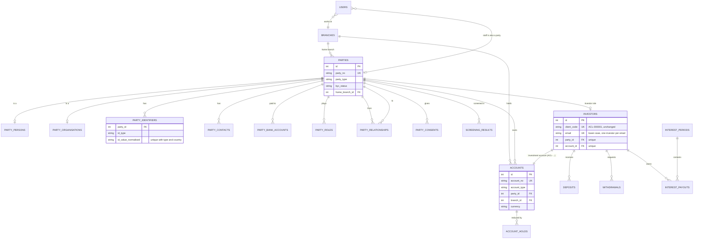
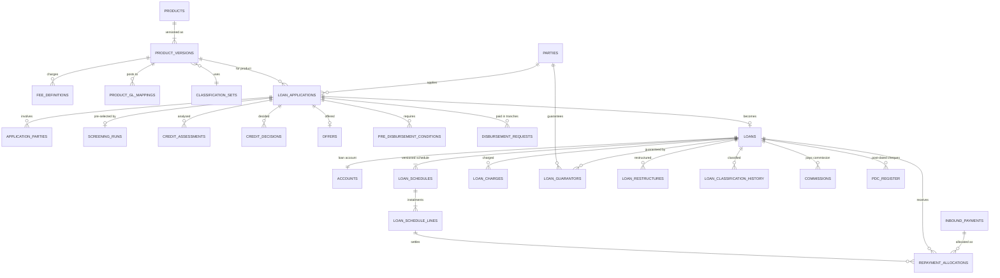
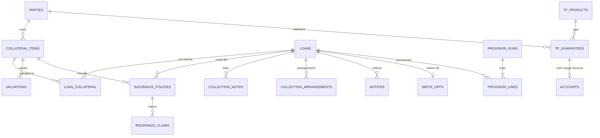
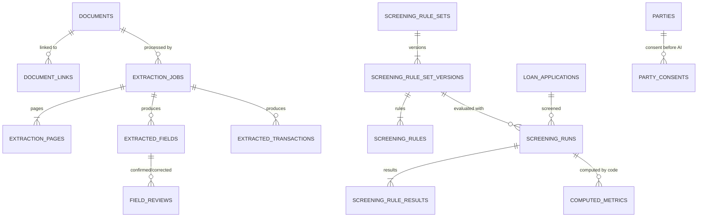
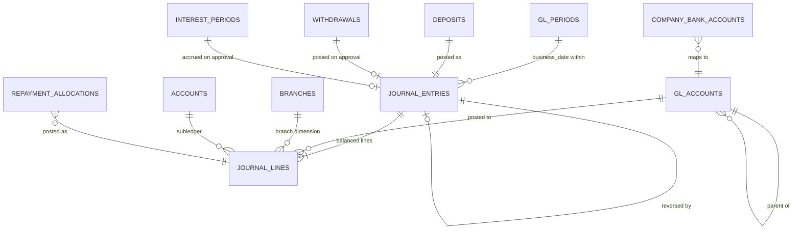

# 02 — Domain model

This document covers every entity the system needs for **both** businesses: investments (funding) and lending, plus documents/AI, the general ledger and cross-cutting tables. Field lists show the *key* fields only. Every table also gets `date_created` / `date_updated` from `Base`, as today.

**Conventions carried over from `CLAUDE.md`**

| Concern | Convention |
|---|---|
| Money | `NUMERIC(20,2)` plus `currency CHAR(3)`. |
| Rates | `NUMERIC(9,6)` percent plus a period (`year` / `month`). The existing `NUMERIC(7,4)` annual investor rate stays as it is. |
| Dates | Business dates are `DATE` in Nairobi time. Timestamps are `timestamptz` in UTC. |
| Statuses | `CheckConstraint`s. |
| Financial foreign keys | `ondelete="RESTRICT"`. |
| Posted records | Never updated or deleted. Corrections are reversals. |

---

## ADR-02-1 — One party model for every person and company

**Context.** The FSD asks for one customer view showing every relationship ("account holder, signatory, agent, shareholder, guarantor"), duplicate detection by ID/KRA PIN/phone across branches, related-party limits, and directors linked to companies. The same human can be an investor, a borrower, a guarantor for someone else, and a director of a borrowing company. Today only `investors` exists, with identity fields on the investor row.

**Options considered**

| Option | Assessment |
|---|---|
| **A. Separate tables per role** (`investors`, `borrowers`, `guarantors`, `directors`, `agents`, `next_of_kin`), each with its own name/ID/contact columns | Simple at first. But the same person ends up in several tables, so duplicate detection, the single customer view, PEP/watchlist screening and DPA subject-access requests must search and reconcile N tables. Related-party exposure is hard to compute. KYC changes must be made N times. |
| **B. One `parties` table plus `party_roles` and `party_relationships`**, with role-specific data in role tables (`investors`, `loans`, `loan_guarantors` …) | One identity, one KYC record and one consent record per human or company. Duplicates are prevented by unique identifiers. Every role is a row. |
| **C. Party table with roles as boolean flags** | Can't carry role-specific data or history (when someone became or stopped being a guarantor). |

**Decision.** **Option B.** `parties` is the single identity record. Roles (`investor`, `borrower`, `guarantor`, `director`, `shareholder`, `signatory`, `agent`, `next_of_kin`, `employer`, `insurer`, `issuing_bank`, `valuer`) are rows in `party_roles` and/or edges in `party_relationships`. Role-specific business data stays in role tables keyed by `party_id`.

**Consequences**
- KYC, consent, screening and documents attach to the party once and are reused by every role.
- Duplicate prevention lives in one place (`party_identifiers` unique index).
- Next of kin and directors **must also be parties**, which means minimal KYC for them. They can be "lite" parties: name and phone only, with no identifiers required.
- Existing investors must be backfilled into parties (§6). The `investors` table survives as the *investment role* table, so investor codes, URLs, statements and reports don't change.
- Queries for "everything about this person" become joins. A `party_360` read model (SQL view) keeps the UI simple.

## ADR-02-2 — Accounts as the common subledger; member collection account

**Context.** The FSD posts almost everything through a customer **"member collection account" (MCA)**, the customer's current account inside the lender:
- Disbursement credits the MCA.
- Fees are debited from the MCA.
- Repayments are swept from the MCA.
- Liens are placed on it.
- Refunds of cash margin go through it.

Today investors have one running balance (deposits − approved withdrawals) computed in `ledger.py`.

**Options considered**

| Option | Assessment |
|---|---|
| A. No MCA: post loan events directly bank ↔ loan | Simpler, but can't express "net amount payable to client", liens, unallocated customer money, over-payments or check-off remittances that arrive before allocation. |
| B. **Generic `accounts` table** (one row per customer-facing ledger: investment account, collection account, loan account, trade-finance margin account), each a subledger of a GL control account | Every balance has the same shape, the same lien and hold mechanism, and the same "never negative" rule. |

**Decision.** **Option B.**
- An `accounts` row exists per customer-facing ledger, with a human account number, type, party, branch, currency, product version and status.
- The **investor's existing running balance becomes an `investment` account**, whose number *is* the existing `ACL-…` client code.
- Borrowers get one `collection` (MCA) account per party per branch, plus one `loan` account per loan.

**Consequences**
- **One balance rule for all accounts.** `ledger.py`'s successor computes every account balance from GL lines tagged with `account_id` (see 03).
- **Liens and holds** become `account_holds`, reducing *available* balance without moving money. This also covers the FSD's "lien placement amount that secured a loan".
- **No account type may go negative except loan accounts, and only within their schedule.** This is the generalisation of today's rule.

## ADR-02-3 — Branches from day one

**Context.** The FSD needs branch codes on customers, accounts, staff, reports, trial balances per branch, and inter-branch accounts. Anchorstone may have only one office at launch (Q-M4).

**Decision.** Add `branches` in phase 2.
- `branch_id` is **NOT NULL** on parties (home branch), accounts, loans, applications, journal lines and staff users.
- Everything existing is backfilled to one head-office branch (code `000`, name per Q-M4).
- Inter-branch due-to/due-from accounts are generated by the posting engine whenever one journal touches two branches (03 §4.4).

**Consequences**
- No painful retrofit later. Single-branch operation costs one extra column.
- Report filters and per-branch TBs come for free.
- Data scoping in RBAC (ADR-04-4) can use the branch.

## ADR-02-4 — Currency on every monetary record; KES only at launch

**Context.** The FSD mentions KSh/FCY loans and FX revaluation. Anchorstone is KES only (`CLAUDE.md`).

**Decision.**
- Every monetary table gets `currency CHAR(3) NOT NULL DEFAULT 'KES'` with `CHECK (currency = 'KES')`.
- Journal entries are single-currency (all lines share the entry's currency).
- `exchange_rates` exists but is unused.
- Enabling FCY later means relaxing the check constraint and turning on revaluation posting rules (03 §5.8). No column additions.

**Consequences**
- Every sum must group by currency. Today's code assumes KES. That stays true while the check constraint holds.
- `fmt_kes()` becomes `fmt_money(amount, currency)` when FCY is enabled.

## ADR-02-5 — Configurable product engine with immutable product versions

**Context.**
- The FSD's products (Mathree, Supa Salo, executive advance …) are examples.
- Anchorstone defines its own products, and must be able to change pricing without changing existing loans.
- The fee tables, penalty rules, day count, interest method, schedule type, classification thresholds and posting accounts all vary by product.

**Options considered**

| Option | Assessment |
|---|---|
| A. Hard-coded product classes | Fails the brief. |
| B. One `products` row edited in place | Silently changes live loans. |
| C. **`products` + immutable `product_versions`** (parameters frozen when published, maker-checker to publish); each loan references the version it was booked on | Pricing can change without touching existing loans. |

**Decision.** **Option C.**
- Typed columns cover what code branches on:
  - `product_kind`: `term_loan`, `revolving`, `checkoff`, `trade_guarantee`, `investment`.
  - `interest_method`: `flat`, `reducing`, `none`.
  - `rate_period`, `day_count`, `schedule_type`, `repayment_frequency`.
  - `penalty_enabled`, `penalty_rate`, `penalty_grace_days`.
  - Allocation waterfalls.
  - Classification bucket set.
- Child tables `fee_definitions` and `product_gl_mappings` hold the rest.

**Consequences**
- A loan's behaviour is fully reproducible from its product version.
- Admins can add products with no deployment.
- New *kinds* of behaviour (a schedule type nobody has seen) still need code. That's intended.

---

## 1. Entity catalogue

### 1.1 Organisation and people

| Entity | Key fields | Notes |
|---|---|---|
| `branches` | `id`, `code` (unique, e.g. `000`), `name`, `region`, `county`, `town_class` (urban / peri-urban / rural), `status`, `opened_on` | Reference data, maker-checker on change. |
| `parties` | `id`, `party_no` (unique, see §5), `party_type` (`person` / `organisation`), `display_name`, `home_branch_id`, `customer_category` (ref), `risk_rating`, `is_pep`, `kyc_status` (`incomplete` / `pending_review` / `verified` / `expired`), `status` (`active` / `dormant` / `blacklisted` / `merged`), `merged_into_party_id`, `relationship_manager_user_id` | The single identity. `display_name` is derived from the person/organisation rows. |
| `party_persons` | `party_id` (PK/FK), `salutation`, `first_name`, `middle_name`, `last_name`, `gender`, `date_of_birth`, `marital_status`, `nationality`, `residency` (local / foreign), `occupation`, `employer_party_id`, `income_bracket` | 1:1 with a person party. |
| `party_organisations` | `party_id` (PK/FK), `legal_name`, `trading_name`, `registration_no`, `registration_date`, `org_type` (SME / corporate / cooperative / NGO / investment group / public institution / SACCO / church / fund manager / insurer), `sector`, `nature_of_business` | 1:1 with an organisation party. |
| `party_identifiers` | `id`, `party_id`, `id_type` (`national_id` / `passport` / `alien_id` / `kra_pin` / `company_reg_no` / `birth_cert`), `id_value_normalised`, `id_value_display`, `issuing_country`, `issued_on`, `expires_on`, `verified_by`, `verified_at`, `source_document_id` | **Unique `(id_type, issuing_country, id_value_normalised)`** prevents duplicate customers. Normalisation: upper case, no spaces or dashes. |
| `party_contacts` | `id`, `party_id`, `kind` (`email` / `mobile` / `phone` / `postal` / `physical`), `value`, `is_primary`, `verified_at` | Phone numbers stored in E.164 (`+2547…`). A shared phone warns but doesn't block. |
| `party_addresses` | `id`, `party_id`, `kind` (home / business / postal), `line1`, `town`, `county`, `country` | — |
| `party_bank_accounts` | `id`, `party_id`, `kind` (`bank` / `mpesa`), `bank_name`, `branch_name`, `account_no`, `account_name`, `is_default_payout`, `verified_at` | Replaces `investors.payout_method` / `bank_name` / `payout_account` (§6). |
| `party_roles` | `id`, `party_id`, `role`, `status`, `started_on`, `ended_on`, `branch_id` | Role facts that have no richer table. |
| `party_relationships` | `id`, `from_party_id`, `to_party_id`, `relationship` (`director` / `shareholder` / `signatory` / `next_of_kin` / `guarantor_of` / `referred_by` / `employee_of` / `related_party` / `advisor_of`), `share_pct`, `kin_relationship`, `started_on`, `ended_on` | Directors, shareholders, next of kin, financial-advisor sub-accounts (FSD p.63), related-party groups. |
| `party_mandates` | `id`, `party_id`, `rule` (`any_one` / `all` / `a_and_b` / `custom`), `description`, `effective_from` | Signing rules for organisations and joint holders. |
| `party_consents` | `id`, `party_id`, `purpose` (`kyc_processing` / `ai_document_processing` / `credit_bureau_check` / `marketing`), `granted_at`, `withdrawn_at`, `channel`, `notice_version`, `evidence_document_id` | Kenya DPA consent record (05 §9). |
| `watchlist_entries` | `id`, `list` (`internal_blacklist` / `pep` / `sanctions_un`), `name`, `identifiers` (jsonb), `reason`, `source`, `added_by`, `added_at`, `removed_at` | — |
| `screening_results` | `id`, `party_id`, `screened_at`, `lists_version`, `matches` (jsonb), `outcome` (`clear` / `potential_match` / `confirmed_match`), `reviewed_by` | — |
| `users` *(exists)* | + `branch_id`, `department_id`, `party_id` (nullable, for staff who are also customers/borrowers), `status` | Staff loans need the staff member as a party. RBAC tables are in 04. |

### 1.2 Accounts (all customer-facing ledgers)

| Entity | Key fields | Notes |
|---|---|---|
| `accounts` | `id`, `account_no` (unique), `account_type` (`investment` / `collection` / `loan` / `tf_margin`), `party_id`, `branch_id`, `product_version_id`, `currency`, `status` (`active` / `dormant` / `frozen` / `closed`), `opened_on`, `closed_on`, `gl_control_account_id` | A subledger of a GL control account. Its balance comes from `journal_lines` (03). |
| `account_holds` | `id`, `account_id`, `amount`, `reason` (`loan_lien` / `legal` / `written_off_recovery` / `pending_withdrawal`), `reference_type`, `reference_id`, `placed_by`, `placed_at`, `released_by`, `released_at` | Reduces the available balance. The existing "pending withdrawals reduce available balance" rule becomes a hold. |
| `number_sequences` | `name`, `prefix`, `next_value`, `format` | One allocator for party numbers, loan numbers, journal numbers, voucher numbers. Uses `SELECT … FOR UPDATE`, or a PostgreSQL sequence per name (as `investor_client_code_seq` does today). |

### 1.3 Investments (funding) — mostly existing

| Entity | Key fields | Notes |
|---|---|---|
| `investors` *(exists)* | `id`, `client_code` (`ACL-…`, unique, **unchanged**), `full_name`, `email` (statement email, unique lower-case, **unchanged rule**), + `party_id` (unique), + `account_id` (unique), `status`, `notes` | Becomes the investment-role table. Identity columns move to the party (§6). |
| `deposits` *(exists)* | + `currency`, + `journal_entry_id`, + `reversal_journal_entry_id`, + `received_into_bank_account_id` | — |
| `withdrawals` *(exists)* | + `currency`, + `journal_entry_id`, + `paid_from_bank_account_id` | — |
| `interest_rates` *(exists)* | + `product_version_id` (nullable at first) | Today one flat rate for all investors. |
| `interest_periods` / `interest_payouts` *(exist)* | + `currency`, + `accrual_journal_entry_id`, + `payment_journal_entry_id` (per payout) | — |
| `placement_receipts` *(future, only if Q-M1 = term placements)* | `id`, `account_id`, `principal`, `rate`, `tenor_days`, `booked_on`, `matures_on`, `payout_frequency`, `maturity_instruction` (`transfer_all` / `renew_principal` / `renew_p_and_i`), `status`, `rolled_from_id` | FSD private placements. Not built unless management confirms. |

### 1.4 Products

| Entity | Key fields | Notes |
|---|---|---|
| `products` | `id`, `code`, `name`, `product_kind`, `status`, `current_version_id` | The name is Anchorstone's own. |
| `product_versions` | `id`, `product_id`, `version_no`, `published_at`, `published_by`, `approved_by`, `effective_from`, `currency`, `interest_method`, `rate_type` (fixed / variable), `default_rate`, `min_rate`, `max_rate`, `rate_period`, `day_count` (`ACT/365F` / `ACT/ACT` / `30/360`), `schedule_type` (`amortising` / `interest_only_bullet` / `full_bullet` / `revolving`), `repayment_frequency`, `min_amount`, `max_amount`, `min_tenor`, `max_tenor`, `penalty_enabled`, `penalty_rate`, `penalty_basis` (overdue instalment / overdue balance), `penalty_grace_days`, `allocation_order` (jsonb: e.g. `["penalty","interest","fees","principal"]`), `disposal_allocation_order`, `classification_set_id`, `max_restructures`, `requires_collateral`, `requires_guarantor`, `prepayment_rule`, `parameters` (jsonb, validated against a schema) | **Immutable once published** (ADR-02-5). |
| `fee_definitions` | `id`, `product_version_id`, `code`, `name`, `basis` (`fixed` / `pct_of_principal` / `pct_of_balance`), `amount`, `rate`, `frequency` (`once` / `monthly` / `on_event`), `trigger_event` (`disbursement` / `restructure` / `review` / `early_settlement` / `overdue`), `treatment` (`deduct_at_disbursement` / `capitalise` / `bill_separately`), `income_or_settlement` (`income` / `pass_through`), `gl_account_id` | Resolves C-5, C-11. "Settlement GL" fees (tracking, risk fund) are `pass_through`. |
| `product_gl_mappings` | `product_version_id`, `role` (`loan_principal` / `interest_receivable` / `interest_income` / `interest_suspense` / `penalty_receivable` / `penalty_income` / `penalty_suspense` / `provision_expense` / `provision_allowance` / `write_off_expense` / `recovery_income`), `gl_account_id` | Feeds the posting engine (03 §4). |
| `classification_sets` / `classification_buckets` | `set_id`, `class` (`normal` / `watch` / `substandard` / `doubtful` / `loss`), `min_dpd`, `max_dpd`, `accrual_status` (`accrue` / `suspend`), `provision_rate` | Resolves C-7: thresholds per product. |
| `party_pricing_overrides` | `party_id`, `product_id`, `fee_code` or `rate`, `value`, `effective_from`, `approved_via_change_request_id` | "Preferential charges at customer level under maker-checker". |
| `employers` | `party_id` (organisation), `checkoff_agreement_no`, `remittance_day`, `contact` | Check-off. |

### 1.5 Origination (applications to disbursement)

| Entity | Key fields | Notes |
|---|---|---|
| `loan_applications` | `id`, `application_no`, `applicant_party_id`, `product_version_id`, `branch_id`, `amount_requested`, `tenor`, `purpose`, `relationship_manager_user_id`, `referred_by_party_id` (agent), `channel`, `status` (`draft` → `documents_pending` → `extracting` → `in_review` → `screened` → `credit_analysis` → `committee` → `approved` / `declined` / `withdrawn` → `offer_issued` → `offer_accepted` → `disbursement_requested` → `disbursed`), `screening_run_id`, `decision`, `decided_by`, `decided_at` | The AI pipeline runs between `documents_pending` and `credit_analysis` (05). |
| `application_parties` | `application_id`, `party_id`, `role` (`applicant` / `co_applicant` / `guarantor` / `director`) | Guarantors and directors attached to an application. |
| `credit_assessments` | `id`, `application_id`, `analyst_user_id`, `affordability` (jsonb), `recommended_amount`, `recommended_rate`, `conditions`, `recommendation`, `submitted_at` | Human credit analysis. Separate from AI. |
| `credit_decisions` | `id`, `application_id`, `level` (`officer` / `branch_manager` / `credit_committee`), `decision`, `approved_amount`, `conditions`, `decided_by`, `decided_at` | Multi-level approval by amount (ADR-04-1, policies). |
| `offers` | `id`, `application_id`, `document_id` (offer letter), `fee_schedule` (jsonb snapshot), `issued_at`, `accepted_at`, `expires_at` | — |
| `pre_disbursement_conditions` | `id`, `application_id`, `condition`, `status`, `satisfied_by`, `evidence_document_id` | Collateral perfected, insurance in place, first IPF instalment paid, etc. |
| `disbursement_requests` | `id`, `application_id`, `loan_id`, `tranche_no`, `amount`, `payee_bank_account_id`, `status` (`pending` / `approved` / `paid` / `rejected`), `requested_by`, `approved_by` | Staged disbursements are several tranches. Maker-checker. |

### 1.6 Loans (servicing)

| Entity | Key fields | Notes |
|---|---|---|
| `loans` | `id`, `account_id` (type `loan`), `loan_no`, `application_id`, `party_id`, `product_version_id`, `branch_id`, `currency`, `principal`, `rate`, `rate_period`, `interest_method`, `day_count`, `disbursed_on`, `first_due_on`, `maturity_on`, `status` (`active` / `closed` / `written_off` / `restructured`), `classification`, `days_past_due`, `accrual_status` (`accruing` / `suspended` / `stopped`), `flags` (litigation, interest_stopped, in_duplum_breached), `restructure_count`, `referred_by_party_id`, `relationship_manager_user_id` | — |
| `loan_guarantors` | `loan_id`, `guarantor_party_id`, `amount_guaranteed`, `relationship`, `document_id` | — |
| `loan_schedules` | `id`, `loan_id`, `version_no`, `reason` (`origination` / `rate_change` / `reschedule` / `restructure` / `prepayment`), `effective_from`, `is_current`, `created_by`, `approved_via_change_request_id` | Schedules are versioned, never edited. |
| `loan_schedule_lines` | `id`, `schedule_id`, `instalment_no`, `due_on`, `principal_due`, `interest_due`, `fees_due` (jsonb by fee code), `total_due` | Paid amounts are derived from allocations, not stored on the line. |
| `loan_charges` | `id`, `loan_id`, `fee_code`, `amount`, `charged_on`, `reason`, `journal_entry_id`, `waived_by_change_request_id` | Ad-hoc and recurring fees, storage fees, restructure fees. |
| `accrual_runs` | `id`, `business_date`, `kind` (`interest` / `penalty` / `suspense_transfer`), `status`, `loans_processed`, `journal_entry_id` (one summary journal per run, plus per-loan subledger lines) | Idempotent per business date (ADR-04-3). |
| `loan_classification_history` | `loan_id`, `as_of`, `days_past_due`, `class`, `accrual_status`, `changed_by` (`system` / user) | — |
| `inbound_payments` | `id`, `source` (`mpesa_c2b` / `bank_transfer` / `cheque` / `cash` / `checkoff_remittance` / `collateral_disposal`), `external_ref` (unique per source), `amount`, `currency`, `received_on`, `payer_msisdn` / `payer_name`, `bill_ref` (account number typed by the payer), `status` (`unmatched` / `matched` / `allocated` / `refunded` / `suspense`), `matched_account_id`, `journal_entry_id` | Every incoming shilling lands here first. Unmatched money sits in suspense (03). |
| `repayment_allocations` | `id`, `inbound_payment_id` or `collection_sweep_id`, `loan_id`, `schedule_line_id`, `component` (`penalty` / `interest` / `fees` / `principal` / `overpayment`), `amount`, `journal_line_id` | The waterfall result. Reversal is a negative allocation through a reversal journal. |
| `pdc_register` | `id`, `loan_id`, `cheque_no`, `bank`, `amount`, `bank_on`, `status` (`held` / `banked` / `bounced` / `returned`) | — |
| `loan_restructures` | `id`, `loan_id`, `kind` (`restructure` / `reschedule` / `top_up` / `refinance`), `old_schedule_id`, `new_schedule_id`, `reason`, `fee_charge_id`, `change_request_id` | Enforces `max_restructures`. |
| `commissions` | `id`, `loan_id`, `payee_party_id` (agent) or `payee_user_id` (staff), `rate`, `gross`, `tax_rate`, `tax`, `net`, `status` (`accrued` / `paid`), `journal_entry_id` | — |

### 1.7 Collateral, insurance, recoveries, provisioning

| Entity | Key fields | Notes |
|---|---|---|
| `collateral_items` | `id`, `collateral_type` (`motor_vehicle` / `land` / `debenture` / `set_off` / `guarantee` / `tbill_bond` / `shares` / `deposit_lien` / `other`), `owner_party_id`, `description`, `identifier` (reg no., title no.), `location`, `omv`, `fsv`, `insured_value`, `last_valued_on`, `next_valuation_due`, `status` (`proposed` / `perfected` / `released` / `repossessed` / `disposed`), `attributes` (jsonb, type-specific), `currency` | The owner may be the borrower or a guarantor. |
| `loan_collateral` | `loan_id`, `collateral_id`, `pledged_value`, `charge_rank`, `perfected_on`, `released_on` | **Many-to-many** (shared collateral). |
| `valuations` | `id`, `collateral_id`, `valuer_party_id`, `valued_on`, `omv`, `fsv`, `document_id` | — |
| `insurance_policies` | `id`, `policy_no`, `insurer_party_id`, `agency`, `kind` (`comprehensive` / `third_party` / `credit_life` / `owners_goods` / `general_cartage`), `insured_object_type` (`collateral` / `loan` / `party`), `insured_object_id`, `sum_insured`, `premium`, `receipt_no`, `starts_on`, `expires_on`, `status` | Credit life attaches to the loan. Asset cover attaches to collateral. |
| `insurance_claims` | `id`, `policy_id`, `lodged_on`, `amount`, `status`, `settled_amount` | — |
| `collection_notes` | `id`, `loan_id`, `kind` (`note` / `call` / `visit` / `system_event` / `letter`), `body`, `created_by`, `created_at`, `promise_to_pay_on`, `promise_amount` | The recoveries diary. |
| `collection_arrangements` | `id`, `loan_id`, `terms` (jsonb), `starts_on`, `ends_on`, `status`, `breached_on` | Special arrangements, monitored by EOD. |
| `notices` | `id`, `loan_id`, `notice_type` (`reminder` / `demand` / `proclamation` / `repossession` / `sale` / `clearance`), `document_id`, `issued_on`, `channel` | — |
| `write_offs` | `id`, `loan_id`, `principal`, `interest_suspended`, `penalty_suspended`, `fees`, `approved_via_change_request_id`, `journal_entry_id`, `written_off_on` | — |
| `provision_runs` / `provision_lines` | `run_id`, `as_of`, `method` (`regulatory_buckets` / `ifrs9_ecl`), `loan_id`, `exposure`, `collateral_value`, `rate`, `required`, `previous`, `movement`, `journal_entry_id` | — |

### 1.8 Trade finance

| Entity | Key fields | Notes |
|---|---|---|
| `tf_products` | `id`, `code`, `kind` (`bid_bond` / `performance_bond` / `apg` / `bank_guarantee` / `letter_of_credit`), `max_unsecured`, `cash_margin_pct`, `commission_rate`, `commission_period` (quarter), `min_commission`, `max_tenor_months` | Configurable. The FSD values are examples. |
| `tf_guarantees` | `id`, `reference`, `party_id`, `tf_product_id`, `issuing_bank_party_id`, `beneficiary_party_id`, `amount`, `currency`, `cash_margin`, `margin_account_id` (type `tf_margin`), `commission_charged`, `issued_on`, `expires_on`, `status` (`requested` / `aml_hold` / `approved` / `issued` / `expired` / `called` / `cancelled`), `aml_screening_result_id` | Contingent exposure. Off-balance-sheet memo posting (03 §5.6). |

### 1.9 Documents and AI (details in 05)

| Entity | Key fields | Notes |
|---|---|---|
| `documents` | `id`, `document_type`, `title`, `storage_key`, `sha256`, `size_bytes`, `mime_type`, `pages`, `encryption_key_id`, `wrapped_data_key`, `sensitivity` (`personal` / `confidential` / `internal`), `uploaded_by`, `uploaded_at`, `retention_until`, `legal_hold`, `deleted_at`, `deleted_by` | The file lives in object storage (ADR-04-2). |
| `document_links` | `document_id`, `entity_type` (`party` / `application` / `loan` / `collateral` / `insurance_policy` / `tf_guarantee` / `email`), `entity_id`, `purpose` | One document can attach to several records. |
| `extraction_jobs`, `extraction_pages`, `extracted_fields`, `extracted_transactions`, `field_reviews` | See 05 §5 | — |
| `screening_rule_sets`, `screening_rule_set_versions`, `screening_rules`, `screening_runs`, `screening_rule_results`, `computed_metrics` | See 05 §7 | — |

### 1.10 General ledger and finance (details in 03)

| Entity | Key fields | Notes |
|---|---|---|
| `gl_accounts` | `id`, `code`, `name`, `account_class` (asset / liability / equity / income / expense / memo), `normal_side` (debit / credit), `parent_id`, `is_control` (subledger required), `is_postable`, `allow_manual_posting`, `currency`, `status` | Chart of accounts (content: Q-F1). |
| `gl_periods` | `id`, `period_start`, `period_end`, `status` (`open` / `soft_closed` / `closed`), `closed_by`, `closed_at` | Generalises today's interest-period lock. |
| `journal_entries` | `id`, `journal_no`, `business_date` (value date), `posted_at`, `source_type`, `source_id`, `event_code`, `currency`, `description`, `status` (`posted`), `reverses_entry_id`, `reversed_by_entry_id`, `created_by`, `approved_by`, `branch_id` (originating) | Immutable. |
| `journal_lines` | `id`, `entry_id`, `line_no`, `gl_account_id`, `branch_id`, `account_id` (subledger, nullable), `debit`, `credit`, `product_id`, `cost_centre`, `memo` | A CHECK makes each line debit **or** credit, not both. |
| `journal_drafts` / `journal_draft_lines` | As above, mutable, may be unbalanced | Manual journals before maker-checker. |
| `posting_rules` | `event_code`, `product_kind`, `version`, `rule` (jsonb template) | 03 §4.2. |
| `company_bank_accounts` | `id`, `bank`, `account_no`, `gl_account_id`, `mpesa_shortcode`, `currency` | Anchorstone's own accounts and paybill. |
| `bank_statement_lines` / `bank_reconciliations` | `id`, `company_bank_account_id`, `value_date`, `amount`, `description`, `matched_journal_line_id`, `status` | — |
| `fixed_assets` / `depreciation_runs` | `id`, `category`, `asset_no`, `name`, `supplier`, `cost`, `purchased_on`, `useful_life_months`, `method`, `location`, `status` | — |
| `prepayments` | `id`, `description`, `amount`, `starts_on`, `months`, `expense_gl_id`, `prepaid_gl_id` | — |
| `borrowings` | `id`, `lender_party_id`, `principal`, `rate`, `drawn_on`, `maturity_on`, `interest_frequency`, `wht_rate` | Long-term funding. |
| `securities_holdings` | `id`, `kind` (`tbill` / `bond`), `classification` (`FVPL` / `HTM`), `face_value`, `cost`, `coupon`, `maturity_on` | Treasury. |
| `exchange_rates` | `currency`, `rate_date`, `rate` | Unused at launch (ADR-02-4). |
| `budgets` | `period`, `gl_account_id` or metric, `branch_id`, `amount` | For budget vs actual reports. |

### 1.11 Cross-cutting (details in 04)

| Entity | Key fields | Notes |
|---|---|---|
| `change_requests`, `change_request_events`, `approval_policies` | 04 §1 | Generic maker-checker. |
| `departments`, `roles`, `permissions`, `role_permissions`, `user_roles`, `user_branch_scopes`, `transaction_limits` | 04 §4 | RBAC. |
| `jobs` (queue) and `batch_runs` / `business_days` | 04 §3 | EOD/EOM/EOY. |
| `email_outbox` *(exists)* → `notifications` | + `channel` (`email` / `sms`), `recipient_msisdn`, `template_code` | Same outbox semantics for SMS. |
| `audit_logs` *(exists)* | + immutability trigger | — |
| `data_access_logs` | `user_id`, `party_id`, `entity_type`, `entity_id`, `action` (`view` / `download` / `export`), `at`, `ip` | DPA and FSD "users viewing customer data". |

---

## 2. Mermaid ER diagrams

These are split by area for readability. Cardinalities: `||` exactly one, `o|` zero or one, `}o` zero or more, `}|` one or more.

### 2.1 Parties, branches, accounts, investments

### 2.2 Products, origination, loans

### 2.3 Collateral, insurance, recoveries, trade finance

### 2.4 Documents, AI, screening

### 2.5 General ledger

---

## 3. Key relationships and rules

| Rule | Enforcement |
|---|---|
| One identity per real person or company | Unique `party_identifiers (id_type, issuing_country, id_value_normalised)` with a type-specific normaliser. Phone and name matches only *warn*. |
| One investment account per party | `investors.party_id` unique. |
| One investor per statement email (existing rule) | `uq_investors_email_lower` stays on `investors.email`. |
| Directors of a borrowing company are parties | `party_relationships (from=director, to=company, relationship='director')`. The CR12 cross-check in 05 compares these to the CR12 extract. |
| Guarantor is a party with its own KYC | `loan_guarantors.guarantor_party_id`. Guarantor collateral uses `collateral_items.owner_party_id`. |
| Related-party loan limit (FSD: 3) | Computed over the borrower's `related_party` group (`party_relationships`), limit from a configurable parameter. |
| Collateral can secure many loans and a loan many collateral items | `loan_collateral` M:N with `pledged_value`. LTV = Σ outstanding ÷ Σ pledged FSV. |
| Accounts never go negative (except loans within schedule) | `ledger.py` successor check under `lock_account()` (the `lock_investor` generalisation), plus a deferred DB constraint trigger on the account balance for non-loan accounts (03 §3.4). |
| Product behaviour frozen per loan | `loans.product_version_id`. Versions are immutable after publish (trigger). |

## 4. Status machines (summary)

| Record | States |
|---|---|
| Party KYC | `incomplete` → `pending_review` → `verified` → (`expired` when an ID or KRA certificate lapses) → `verified` |
| Application | `draft` → `documents_pending` → `extracting` → `in_review` → `screened` → `credit_analysis` → `committee` → `approved` / `declined` / `withdrawn` → `offer_issued` → `offer_accepted` → `disbursement_requested` → `disbursed` |
| Loan | `active` (`accrual_status` `accruing` ↔ `suspended`, flags) → `closed` / `written_off` / `restructured` (old schedule) |
| Change request | `draft` → `pending` → `approved` → `applied`. Or `pending` → `rejected` / `returned` (→ `pending` again) / `cancelled` / `expired`. |
| Inbound payment | `unmatched` → `matched` → `allocated` (or `suspense` → `matched`, or `refunded`) |
| TF guarantee | `requested` → `aml_hold` → `approved` → `issued` → `expired` / `called` / `cancelled` |

## 5. Numbering

| Number | Format (proposed default; Q-M2) | Notes |
|---|---|---|
| Investment account | **`ACL-000001`** (unchanged) | Already on statements, emails, PDFs and Excel exports. Never renumber. |
| Party number | `P-0000001` (branch-independent) | A customer keeps one number when moving branch. The FSD's 11-digit "branch + product + customer" number is an *account* number, not a person number. |
| Loan account | `{branch:3}{product:3}{seq:5}` = 11 digits, e.g. `00010200042` | Matches the FSD migration rule (p.77) for lending accounts only. |
| Collection account (MCA) | `{branch:3}900{seq:5}` | `900` is a reserved pseudo-product code for MCAs. |
| Application | `APP-2026-000123` | Year-scoped. |
| Journal | `JE-2026-00001234` | Gap-free per year (sequence under lock), as auditors expect. |

---

## 6. Migrating existing investors into the party model

**Goal.** No investor sees a change:
- `ACL-` codes, statement emails, PDFs, URLs (`/investors/<id>`) and API responses stay the same.
- `uq_investors_email_lower` keeps working throughout.

### 6.1 Steps (one Alembic migration plus a data step, in phase 2)

1. **Pre-flight report (read-only command).** List problems that would block unique identifiers:
   - investors sharing an `id_number`;
   - investors sharing a `kra_pin`;
   - `id_number` values that look like passports or alien IDs rather than national IDs;
   - investors with neither.

   Duplicates must be resolved by a person *before* the migration runs. The migration refuses to run while any remain.
2. **Create a head-office branch** (`000`, Q-M4).
3. **For each investor, inside one transaction:**
   - Insert a `parties` row: `party_type='person'` by default; the list goes to investor relations to mark organisations (Q-M7). `display_name = full_name`, `home_branch = 000`, `kyc_status = 'incomplete'` unless ID and KRA PIN are both present. `party_no` from the new sequence.
   - Split `full_name` into `party_persons` first/last name on a best-effort basis (last token = last name), keep `display_name` exact, and flag for review.
   - `party_identifiers`: `id_number` → `national_id` (or `passport` per the pre-flight classification); `kra_pin` → `kra_pin`.
   - `party_contacts`: email (primary), phone (normalised to E.164 where possible; otherwise stored raw and flagged).
   - `party_bank_accounts` from `payout_method` / `bank_name` / `payout_account`, `is_default_payout = true`.
   - `party_roles (role='investor')`.
   - `accounts` row: `account_type='investment'`, `account_no = client_code`, `branch 000`, `currency 'KES'`, `status` from the investor, `opened_on = created_at`.
   - `investors.party_id`, `investors.account_id` set. Then both become NOT NULL and UNIQUE.
4. **Keep `investors.full_name`, `email`, `phone`, `id_number`, `kra_pin` and the payout columns for one phase,** read-only and kept in sync by the service layer, so reports and PDFs don't change in the same release. Remove them in phase 3 once every read goes through the party. The `investors.email` column **stays permanently** as the statement address that carries the one-email-per-investor rule.
5. **The `investor_client_code_seq` sequence is untouched.** New investors still get the next `ACL-` code. Creating an investor now creates (or reuses, after a duplicate check) a party first.

### 6.2 Verification (tests, run in CI and once against a copy of production)

- Every investor has exactly one party and one investment account. `account_no == client_code`.
- Counts match: investors = parties with the investor role = investment accounts.
- No identifier collision. Each party's email equals its investor's email.
- All existing API responses for `/investors`, `/investors/<id>`, statements and reports are **byte-for-byte identical** before and after (golden-file tests over the demo database).
- The balance of every investor is unchanged. Balances don't move in phase 2; GL migration is phase 4 (03 §7).

### 6.3 What changes for staff

- Adding an investor runs the duplicate check. If the person already exists as a borrower or guarantor, staff see "existing party found — attach investor role?" instead of creating a second record.
- Editing name, ID or KRA PIN becomes a **maker-checker change request** if Q-M5 says so (default: yes for identity fields, no for phone and address).
