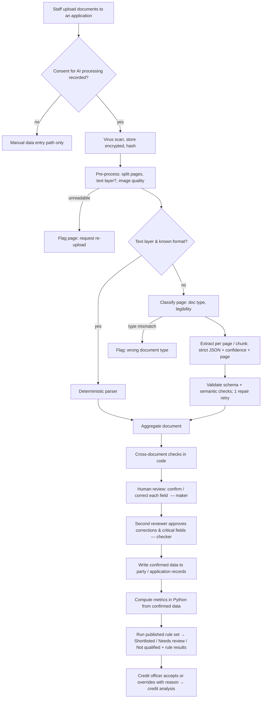

# 05 — AI document extraction and applicant pre-selection

This is new; it isn't in the FSD.
- **What it does:** extract data from clients' scanned documents with the Claude API, have staff confirm it, compute metrics in code, and run admin-configured rules that sort loan applicants into **Shortlisted / Needs review / Not qualified** *before* credit analysis.
- **What it doesn't do:** the AI never makes a credit decision, never rejects anyone, and never does the arithmetic that decisions depend on.

> **Built so far: phase 3a, AI document extraction** (`backend/app/DocAI/`). It covers §2 (all types plus the
> CRB report), §3, §5, §6.1 (per-page and running-balance checks, page continuity) and §10, a first set of §6.2
> statement metrics, and §11 retries and cost per call. It differs from this design in four ways:
> - The model and the price table are **business settings** (`ai.model_extract`, which needs two approvers, and
>   `ai.price_table`), not the `AI_MODEL_*` / `AI_PRICE_TABLE` environment variables of ADR-05-2. Only the key
>   (`ANTHROPIC_API_KEY`) and `AI_REQUEST_TIMEOUT_S` are environment.
> - The SDK wrapper is `client.py` and the orchestration is `extractor.py`. There's **no separate classification
>   call**: every answer carries `detected_document_type` and `readable`.
> - Statement transaction rows carry one confidence and the page (not a full envelope per cell). Statement
>   metrics are computed from the extraction (before human review) and **only when every page balances**.
> - Not built yet (3b and later): deterministic parsers (ADR-05-4), image quality pre-checks other than
>   HEIC / locked / damaged files, the review screen and maker-checker confirmation (§8), cross-document checks,
>   rules and screening (§7), budgets and the circuit breaker (§11), and the evaluation harness (§12).
>
> **Phase 3b, review and pre-selection** (`backend/app/Applications/`, `frontend/src/pages/applications/`):
> - A **temporary pre-screen application** (WA-04 products, an instalment *estimate*) that phase 5 replaces.
> - The **review screen** with maker-checker (`ai.review`): corrections sit beside AI values, and approval fills only
>   empty client values.
> - **Cross-document checks** (§7.0, the four used by the brief).
> - The **rule set as a setting** (`screening.rule_set`, the WA-10 rules), changed through `settings.change`, rather
>   than the separate rule-set tables of §7.2.
> - **Deterministic screening runs.**
> - **Human decisions**, with a second approver for proceeding against "Not qualified".
> - The **decision log** and the **usage and accuracy views**.
>
> Not built yet: backtesting a rule-set draft (§7.2), `screening replay` as a CLI (the tests re-evaluate stored runs
> instead), budgets, and the "confirm all" bulk action (Q-C8).
>
> **Requirement IDs**, as used by the phase briefs. The FSD's §15 rows have no numbers.
>
> | ID | Requirement | Code | Tests |
> |---|---|---|---|
> | AI-01 | Consent first | `Jobs/queue.py` `assert_consent`, `DocAI/service.py` | `test_docai.py`: no consent, withdrawn consent |
> | AI-02 | Secure processing (server only, key in config) | `DocAI/client.py` | `test_docai.py`: SDK imports, key never leaks |
> | AI-03 | Page reference and confidence; unreadable → rescan | `DocAI/schemas/`, `extractor.py`, `validators.py` | `test_docai.py` |
> | AI-04 | Long statements page by page, balances checked | `DocAI/statements.py` | `test_docai_statements.py` |
> | AI-05 | Calculations by the system | `DocAI/metrics.py`, `Applications/screening.py` | `test_docai_statements.py`, `test_ai_rules.py` |
> | AI-06 | Cross-checks | `Applications/checks.py` | `test_ai_checks.py` (`test_ai_06_*`) |
> | AI-07 | Staff confirmation with maker-checker | `Applications/review.py`, CRB in `service.py` / `handlers.py` | `test_ai_review.py`, `test_applications.py` (`test_ai_07_*`) |
> | AI-08 | Pre-screening rules as versioned data | `Applications/ruleset.py`, `screening.py` | `test_ai_rules.py` (`test_ai_08_*`) |
> | AI-09 | People decide | `screening.py` `decide`, `CreditOverride` | `test_ai_rules.py` (`test_ai_09_*`), end-to-end test |
> | AI-10 | Traceability | `DocAI/model.py`, `Applications/reports.py` decision log | `test_docai.py`, `test_ai_end_to_end.py` |
> | AI-11 | Fairness (protected attributes refused) | `Applications/ruleset.py` | `test_ai_rules.py` (`test_ai_11_*`) |
> | AI-12 | Failures and cost | `extractor.py` retries, `reports.py` `usage` | `test_docai.py`, `test_ai_12_*` |
> | AI-13 | Accuracy sign-off evidence | `reports.py` `accuracy` | `test_ai_13_*` |
>
> Schemas are built once from `types.py` by `scripts/build_docai_schemas.py` and never edited. Prompts are
> hand-written files. Both are hashed onto every extraction.

---

## Architectural decisions

### ADR-05-1 — The AI reads; code computes; people decide

**Context.** LLMs are good at reading messy scans and terrible at being accountable. A credit file must be explainable to the client, the auditor and the regulator. The Kenya DPA (s.35) gives data subjects the right not to be subject to a decision based solely on automated processing that significantly affects them.

**Options considered**

| Option | Assessment |
|---|---|
| A. Ask the model to read the documents and return a score or recommendation | Fast to build. Unexplainable and non-reproducible, arithmetic errors, and a prohibited "solely automated" decision. |
| B. **Model extracts structured facts with page references → staff confirm → Python computes metrics → versioned rules produce a recommendation → a credit officer decides** | Every number can be recomputed. Every decision traces to confirmed facts and a rule version. |

**Decision.** **Option B.**
- The model's outputs are **evidence candidates**.
- Only reviewer-confirmed values reach the client record or the rules engine.

**Consequences**
- **More steps:** a review screen is mandatory.
- **Throughput depends on staff review time.** The UI must make review fast (§8).

### ADR-05-2 — Claude API calls only from the backend; key and model in configuration

**Decision.**
- **Single client:** all calls go through one wrapper, `app/DocAI/client.py`, using the official Anthropic Python SDK. It's the **only** module that imports the SDK (a test enforces this).
- **Configuration**, from the environment (`config.py`, documented in `.env.example`):

| Setting | Purpose |
|---|---|
| `ANTHROPIC_API_KEY` | Secret. Never logged, never in the DB, never sent to the frontend. |
| `AI_ENABLED` | Kill switch, default `false`. The manual data-entry path always works. |
| `AI_MODEL_EXTRACT` | Model for field and transaction extraction. **No default in code:** startup fails if it's missing while `AI_ENABLED=true`. |
| `AI_MODEL_CLASSIFY` | Model for classification and legibility. Cheaper. |
| `AI_MODEL_ESCALATE` | Optional stronger model for pages that fail validation twice. |
| `AI_MAX_CONCURRENCY`, `AI_REQUEST_TIMEOUT_S`, `AI_MAX_RETRIES` | Throughput and resilience. |
| `AI_BUDGET_PER_APPLICATION_USD`, `AI_BUDGET_MONTHLY_USD` | Cost guards (§11). |
| `AI_PRICE_TABLE` | Per-model price per million input and output tokens. Configuration, because prices change. |

- **Suggested starting values** (in `.env.example`, chosen by the evaluation harness in §12, not by us): a Sonnet-class model for extraction, a Haiku-class model for classification, an Opus-class model for escalation, using the current Claude 5 family IDs at the time of rollout.
- **Visibility:** super admins can *see* which model is configured on a Settings → AI page, but can't see the key. Changing a model is a deployment config change gated by the evaluation harness, not a UI toggle.

**Consequences.** Switching models is a config change plus an evaluation run. There are no code edits, and no risk of a browser holding the key.

### ADR-05-3 — Strict structured output, validated in code

**Decision.**
- **Schema per document type:** each type has a JSON Schema (versioned in `app/DocAI/schemas/<type>.v<n>.json`).
- **Forced structured output:** each call supplies the schema through the API's structured-output / forced tool-use mechanism, so the model must return a single object matching it.
- **Validation in Python:** the response is then validated again (`jsonschema` + Pydantic models), plus semantic validators (formats, dates, checksums, sums).
- **One repair attempt:** an invalid response gets one retry with the validation errors fed back. If it fails again, the page goes to manual entry, never "best effort".

### ADR-05-4 — Digital-first: parse text when we can, use the AI when we must

**Context.**
- Many M-Pesa and bank statements arrive as **digitally generated PDFs** with a text layer.
- Parsing those deterministically is cheaper, faster and exact.
- Scans and photos need the model.

**Decision.**
- **Detection:** at ingest, pages are checked for a usable text layer (`pdfplumber`).
- **Deterministic parsers** (starting with the Safaricom M-Pesa statement format and the 3–4 banks most seen in applications) extract transactions with **no AI call**.
- **Everything else** goes to the model.
- **Both paths** produce the same `extracted_transactions` rows, with `extracted_by = 'parser:<name>@<version>'` or `'model:<id>'`.

**Consequences.** Lower cost and better accuracy on the most common documents. Parsers are code, so they need tests and maintenance when formats change.

### ADR-05-5 — Pre-selection rules are data, versioned and published through maker-checker

**Decision.**
- **Rules** are declarative JSON over a fixed registry of metrics, fields and checks defined in code. There is no `eval`, no scripting and no AI.
- **Rule sets** are versioned, immutable once published, and published through maker-checker (04 §1).
- **Each screening run** stores the exact rule-set version and the metric values it saw.

See §7.1–7.4.

---

## 1. End-to-end flow



The application status moves: `documents_pending` → `extracting` → `in_review` → `screened` → `credit_analysis` (02 §4).

## 2. Document types

| Type code | Typical source | Fields extracted (summary) | Pages | Notes |
|---|---|---|---|---|
| `national_id` | Kenyan ID front and back (photo) | ID number, full name (as printed), date of birth, sex, place of birth, date of issue, serial no., district | 1–2 images | **The face photo is not processed or stored as a template** (biometric data; Q-CO9). |
| `passport` | Passport bio page | Passport no., surname, given names, nationality, DOB, sex, issue and expiry dates, MRZ lines | 1 | MRZ check digits validated in code. |
| `alien_id` | Alien card | Card no., name, nationality, DOB, expiry | 1–2 | — |
| `kra_pin_certificate` | iTax PIN certificate | PIN, taxpayer name, taxpayer type (individual / non-individual), registration date, tax obligations listed | 1 | PIN format `[A|P]\d{9}[A-Z]` validated in code. |
| `cr12` | Registrar of Companies CR12 | Company name, registration no., date of CR12, registered office, directors (name, ID/passport, nationality, shares), shareholders (name, share class, number), secretary | 1–3 | Feeds the director cross-check. |
| `certificate_of_incorporation` / `business_registration` | Certificate | Entity name, registration no., incorporation/registration date, entity type | 1 | — |
| `bank_statement` | Bank PDF or scan | Bank, branch, account name, account no. (last 4 stored, rest masked), currency, period from/to, opening and closing balances; **transactions:** date, description, debit, credit, running balance, cheque/ref no. | 1–100+ | Page-by-page (§6). |
| `mpesa_statement` | Safaricom statement PDF | Customer name, phone (masked), period, summary table; **transactions:** receipt no., completion time, details, status, paid in, withdrawn, balance | 1–100+ | Deterministic parser first (ADR-05-4). |
| `audited_financials` | Audited accounts | Entity, auditor, year end, opinion type (unqualified / qualified / adverse / disclaimer), revenue, cost of sales, operating profit, finance costs, net profit, total assets, current assets, current liabilities, total liabilities, equity, cash; currency and units (KES / KES '000) | 10–60 | Extract the primary statements pages only. **Ratios are computed in code.** |
| `title_deed` | Title / certificate of lease | Title no., registration section, parcel no., area, registered proprietor(s), tenure (freehold / leasehold, term), encumbrances listed, date | 1–4 | — |
| `logbook` | Vehicle registration certificate | Registration no., make, model, year of manufacture, chassis no., engine no., registered owner(s), co-owner / financier interest, colour | 1–2 | — |
| `valuation_report` | Valuer's report | Valuer firm, valuer name, date of valuation, asset identifier (title or reg no.), OMV, FSV, insurance value, condition notes, validity period | 5–40 | — |

Each type's schema lives in `app/DocAI/schemas/`. Adding a type means a schema, prompt, validators, review layout and evaluation set.

## 3. Calling the model

| Concern | Design |
|---|---|
| Input | The page image (rendered at 200 DPI PNG for scans) or the native PDF page via the API's document support, plus the schema and a versioned prompt. |
| Prompts | Files under `app/DocAI/prompts/<type>/v<n>.md`. The prompt **version and SHA-256** are stored with every call. Prompts instruct: extract only what is printed; return `null` with `legibility` notes rather than guess; never infer missing digits; report the page number; give a 0–1 confidence per field. |
| Per call | One page (scans) or one logical chunk (≤ 5 pages of a text PDF without a parser). The application ID and party IDs are **not** sent. The model doesn't need them. |
| Output envelope | See §5. |
| Logging | Request ID, model ID returned by the API, tokens in/out, latency, cost, attempt number. **The document content and output are not written to application logs** (they go to encrypted storage, §10). |

## 4. Pre-processing, classification and quality

### 4.1 Classification and quality

- **Page split:** PDFs split into pages, images normalised (orientation via EXIF; HEIC → JPEG).
- **Quality gates in code, before any AI call:**
  - minimum pixel dimensions;
  - blur score (variance of Laplacian);
  - blank-page detection;
  - password-protected PDF detection.

  A failure marks the page `unreadable_precheck`.
- **Classification call** (cheap model): returns `{detected_type, legibility: good|partial|unreadable, is_complete_page, notes}`.
  - If `detected_type ≠ declared type`, extraction stops for that document and it's flagged **Wrong document type** (§11). A reviewer can re-declare the type and restart.
  - If legibility is `unreadable`, the page is flagged for re-upload.

### 4.2 Semantic validators (code)

| Check | Rule |
|---|---|
| Kenyan ID | 7–8 digits. DOB plausible (applicant ≥ 18). |
| KRA PIN | Format check. |
| Passport | MRZ check digits. |
| Dates | Valid, not in the future, issue < expiry. |
| Money | Values parse to `Decimal` with exactly 2 decimals. Currency in an allowed set. |
| Statements | Every transaction row's balance arithmetic (see §6). |
| Financials | Assets = liabilities + equity within rounding (reported, not enforced). |
| CR12 | Shareholdings sum to issued shares. |

Validator failures set `field.validation = 'failed'` with a reason shown on the review screen.

## 5. Output schema (common envelope + per-type fields)

Every field, in every document type, has the same shape:

```json
{
  "value": "12345678",
  "confidence": 0.94,
  "source_page": 1,
  "source_text": "ID NO 12345678",
  "legibility": "good",
  "notes": null
}
```

| Property | Meaning |
|---|---|
| `confidence` | The model's self-reported 0–1 score. It's **not calibrated** and is used only to order and highlight review, never to skip it. The evaluation harness measures how well it predicts errors per type (§12). |
| `source_page` | 1-based page number in the *uploaded* document. **Required for every field;** a field without a page fails validation. |
| `source_text` | Short verbatim snippet (≤ 80 chars) so reviewers can see what was read. Masked for account numbers. |

### 5.1 Example: `national_id.v1`

```json
{
  "$id": "national_id.v1",
  "type": "object",
  "required": ["document_type", "fields", "page_count_seen"],
  "properties": {
    "document_type": {"const": "national_id"},
    "page_count_seen": {"type": "integer"},
    "fields": {
      "type": "object",
      "required": ["id_number", "full_name", "date_of_birth", "sex", "date_of_issue"],
      "properties": {
        "id_number":     {"$ref": "#/$defs/stringField"},
        "full_name":     {"$ref": "#/$defs/stringField"},
        "date_of_birth": {"$ref": "#/$defs/dateField"},
        "sex":           {"$ref": "#/$defs/enumField_sex"},
        "place_of_birth":{"$ref": "#/$defs/stringField"},
        "date_of_issue": {"$ref": "#/$defs/dateField"},
        "serial_number": {"$ref": "#/$defs/stringField"}
      },
      "additionalProperties": false
    },
    "warnings": {"type": "array", "items": {"type": "string"}}
  },
  "$defs": {
    "base": {
      "type": "object",
      "required": ["value", "confidence", "source_page"],
      "properties": {
        "confidence":  {"type": "number", "minimum": 0, "maximum": 1},
        "source_page": {"type": "integer", "minimum": 1},
        "source_text": {"type": ["string", "null"], "maxLength": 80},
        "legibility":  {"enum": ["good", "partial", "unreadable"]},
        "notes":       {"type": ["string", "null"]}
      }
    },
    "stringField": {"allOf": [{"$ref": "#/$defs/base"}, {"properties": {"value": {"type": ["string", "null"]}}}]},
    "dateField":   {"allOf": [{"$ref": "#/$defs/base"}, {"properties": {"value": {"type": ["string", "null"], "format": "date"}}}]},
    "enumField_sex": {"allOf": [{"$ref": "#/$defs/base"}, {"properties": {"value": {"enum": ["M", "F", null]}}}]}
  }
}
```

### 5.2 Example: `bank_statement_page.v1` (one call per page)

```json
{
  "document_type": "bank_statement",
  "page_number": 3,
  "header": {
    "account_name":   {"value": "JANE W KAMAU", "confidence": 0.97, "source_page": 3},
    "account_number": {"value": "****4821",     "confidence": 0.91, "source_page": 3},
    "currency":       {"value": "KES",          "confidence": 0.99, "source_page": 3},
    "period_from":    {"value": "2026-03-01",   "confidence": 0.95, "source_page": 3},
    "period_to":      {"value": "2026-08-31",   "confidence": 0.95, "source_page": 3}
  },
  "page_opening_balance": {"value": "152340.15", "confidence": 0.88, "source_page": 3},
  "page_closing_balance": {"value": "98410.00",  "confidence": 0.90, "source_page": 3},
  "transactions": [
    {
      "row": 1,
      "date":        {"value": "2026-04-02", "confidence": 0.96},
      "description": {"value": "MPESA C2B 0722XXXXXX SALES", "confidence": 0.82},
      "debit":       {"value": null, "confidence": 0.97},
      "credit":      {"value": "12500.00", "confidence": 0.93},
      "balance":     {"value": "164840.15", "confidence": 0.90},
      "reference":   {"value": "QJK7H2LM9P", "confidence": 0.75},
      "category":    {"value": "customer_receipt", "confidence": 0.70}
    }
  ],
  "warnings": ["Row 14 partially obscured by stamp"]
}
```

**Money values** are strings (parsed to `Decimal` in code, never floats), the same rule as `CLAUDE.md`.

**`category`** is a *label* from a fixed list:

| Kind | Categories |
|---|---|
| Income-like | `salary`, `customer_receipt`, `transfer_in` |
| Lending | `loan_disbursement`, `loan_repayment` |
| Spending | `betting`, `utility`, `cash_withdrawal`, `transfer_out` |
| Bank events | `bank_charge`, `reversal`, `returned_item` |
| Fallback | `other` |

Code may override the label with keyword rules (§6.2). Labels are evidence; reviewers can change them.

## 6. Long statements and metrics

### 6.1 Chunking

- **Page-by-page:** scanned statements get one call per page. Text PDFs without a parser go in chunks of ≤ 5 pages. **Only the transaction pages are sent;** summary and advertising pages are classified and skipped.
- **Row-level balance check:** in code, for each extracted row, `previous_balance + credit − debit == balance` (to the cent). Mismatches flag the row (a mis-read amount or a missing row).
- **Page continuity:** page *n*'s last balance must equal page *n+1*'s opening or first-row balance. A mismatch indicates a missing page or a mis-read → document flagged `incomplete_or_misread`.
- **Statement-level reconciliation:** `opening_balance + Σcredits − Σdebits == closing_balance`. A statement that fails reconciliation **can't be used for metrics** until a reviewer fixes the flagged rows or marks the statement "not reliable".
- **Page-boundary duplicates:** rows repeated at page breaks are removed by `(date, reference, amount, balance)`.
- **Period coverage:** months covered, gaps of more than N days with no transactions, and whether the period ends within N days of the application date (rule inputs).

### 6.2 Metrics (Python only; registry in `app/Screening/metrics.py`)

Every metric:
- is a pure function of **confirmed** data;
- returns `Decimal` or `int`;
- records which transaction or field IDs it used (`computed_metrics.inputs`);
- is unit-tested with hand-calculated fixtures.

| Metric | Definition (default; parameters configurable) |
|---|---|
| `statement_months_covered` | Whole months between the confirmed period dates. |
| `avg_monthly_inflow_{n}m` | Mean of monthly Σcredits over the last *n* complete months, **excluding** `transfer_in` between the applicant's own accounts (matched by amount and date across the applicant's statements), `reversal`, `loan_disbursement`. |
| `median_monthly_inflow_{n}m` | As above, median. |
| `inflow_consistency_{n}m` | Coefficient of variation of monthly inflows (stdev ÷ mean). Lower is steadier. Plus `months_with_inflow_below_x`. |
| `avg_month_end_balance` / `min_balance` | From running balances. |
| `returned_items_count_{n}m` | Rows labelled `returned_item`, or matching bank keyword rules (`RTD`, `UNPAID`, `RETURNED`, `INSUFF`, `DISHON`). |
| `existing_loan_repayments_monthly` | Average monthly Σ of `loan_repayment` debits (keyword list of lenders, maintained by admins: banks, digital lenders, M-Pesa overdraft and loan products) + recurring same-amount debits to the same payee. |
| `existing_loan_disbursements_{n}m` | Count and Σ of `loan_disbursement` credits. |
| `betting_share_of_outflows` | Σ `betting` ÷ Σ debits. |
| `cash_withdrawal_share` | Σ `cash_withdrawal` ÷ Σ debits. |
| `salary_detected` | Same-payer credits within ±3 days each month for ≥ 3 months. |
| `debt_service_ratio_estimate` | (`existing_loan_repayments_monthly` + proposed instalment from the product schedule) ÷ `avg_monthly_inflow_6m`. |
| Financials: `current_ratio`, `debt_to_equity`, `net_margin`, `interest_cover`, `revenue_growth` | From confirmed audited-financials fields. Units normalised (KES '000 × 1,000). |
| Collateral: `ltv_estimate` | Requested amount ÷ confirmed FSV. |
| KYC: `id_expired`, `kra_pin_present`, `pep_flag`, `watchlist_match` | From party data and screening. |

## 7. Cross-document checks and pre-selection rules (code, not AI)

### 7.0 Cross-document checks

Checks run after extraction (to show issues during review) and again after confirmation (results stored on the screening run). Each check produces `pass | fail | needs_review | not_applicable`, plus evidence (the values compared and their pages).

| Check | Logic |
|---|---|
| `id_number_consistent` | Normalised ID number is identical on the ID document, KRA PIN certificate (where shown), application form and party record. |
| `name_consistent` | Names compared after normalisation (upper case, remove punctuation and titles, sort tokens). Exact token-set match = pass. Fuzzy similarity ≥ threshold (default 0.90, token-set ratio) = needs_review. Below = fail. Handles name order and missing middle names. |
| `dob_consistent` | ID vs passport vs application. |
| `kra_pin_consistent` | KRA certificate PIN = PIN on the application and party record. Taxpayer type matches party type. |
| `company_identity_consistent` | Company name and registration no. agree across CR12, certificate of incorporation, KRA PIN (non-individual) and application. |
| `cr12_directors_match` | Set comparison of CR12 directors (ID/passport first, else name) with directors captured at onboarding (`party_relationships`). Reports missing, extra and mismatched shareholdings. CR12 date must be within N days (default 90). |
| `statement_holder_match` | Bank/M-Pesa account name matches the applicant (or the company for business accounts). |
| `collateral_owner_match` | Logbook registered owner / title deed proprietor = applicant, a guarantor on the application, or the applicant company. Co-owner or financier interest → needs_review. |
| `collateral_identity_match` | Logbook reg/chassis no. or title no. on the valuation report = on the logbook/title deed. |
| `valuation_fresh` | Valuation date within N months (default 12). |
| `document_not_expired` | Passport/alien ID expiry after today. |
| `statement_recent_and_complete` | Ends within N days of application. Covers ≥ M months. Reconciled (§6.1). |

**Thresholds** live in the published rule set (§7.2), not in code.

### 7.1 Rule model

```json
{
  "rule_set": "sme_working_capital",
  "version": 4,
  "applies_to": {"product_codes": ["SME-WC"], "party_types": ["organisation", "person"]},
  "rules": [
    {"id": "R1", "name": "Statement covers 6 months", "check": "statement_months_covered", "op": ">=", "value": 6,
     "on_fail": "needs_review", "on_missing": "needs_review"},
    {"id": "R2", "name": "Average inflow at least 3x instalment", "expr": {"metric": "avg_monthly_inflow_6m", "op": ">=",
      "value": {"mul": [3, {"metric": "proposed_instalment"}]}}, "on_fail": "not_qualified", "on_missing": "needs_review"},
    {"id": "R3", "name": "No more than 2 returned items", "check": "returned_items_count_6m", "op": "<=", "value": 2,
     "on_fail": "needs_review"},
    {"id": "R4", "name": "Identity consistent", "check": "id_number_consistent", "op": "==", "value": "pass",
     "on_fail": "not_qualified", "on_needs_review": "needs_review"},
    {"id": "R5", "name": "Not on internal blacklist", "check": "watchlist_match", "op": "==", "value": false,
     "on_fail": "not_qualified"}
  ]
}
```

| Element | Allowed values |
|---|---|
| Operators | `==`, `!=`, `<`, `<=`, `>`, `>=`, `in`, `between`, and `all` / `any` groups. Arithmetic limited to `add`, `sub`, `mul`, `div` over registered metrics and constants. |
| Terms | Only registered metrics, check results and whitelisted party/application fields. **Protected attributes** (gender, marital status, religion, ethnicity, health) are tagged in the field registry and **can't be referenced**; the publish validator refuses them. Age: Q-CO10. |
| Outcomes | `on_fail` is `needs_review` or `not_qualified`. `on_missing` defaults to `needs_review`. A rule can never output "approved". |

### 7.2 Versioning and publishing

- **Drafts:** a `screening_rule_set_version` is editable in `draft`.
- **Publishing** is a change request (`screening.publish_ruleset`): maker ≠ checker, permission `screening.rules.publish`. Published versions are immutable (trigger).
- **Backtest before publish:** the publish screen shows a **backtest**, running the draft against the last N screened applications using their *stored* metrics. Reviewers see how many outcomes would change.
- **Version capture:** each application is screened with the rule set version that is current *at the time of screening*. That version ID is stored, and rescreening after a rule change is a new run (old runs are kept).

### 7.3 Outcome

1. **Any** rule with `on_fail = not_qualified` failed → **Not qualified** (a recommendation).
2. Otherwise, any `needs_review` failure, missing input, failed cross-check, unreconciled statement or low-quality document → **Needs review**.
3. Otherwise → **Shortlisted**.

The run stores every rule's result (`passed` / `failed` / `missing`), the values compared and a human-readable explanation, e.g. "Average monthly inflow KES 84,210.55 is below 3 × instalment (KES 96,000.00)".

### 7.4 People decide, always

- **Rule inputs:** rules only see **human-confirmed** data (§8). The AI's raw values never reach a rule.
- **Not qualified:** a credit officer must open the application and either **decline with a reason** (a human decision, audited) or **override to proceed**.
  - The override needs a reason and a checker (`screening.override`, maker-checker).
  - Overrides are reported monthly to risk.
- **Shortlisted** still goes to full credit analysis. Pre-selection only orders the queue and flags issues.
- **Declining:** the client is never told "the AI rejected you". Declines are issued by staff using standard templates.

## 8. Human review screen

| Area | Design |
|---|---|
| Layout | **Left:** page viewer with zoom, showing the page each field came from (and the region if the model returned `source_text`). **Right:** fields grouped by document, each with value, confidence badge, validation status, cross-check status and history. |
| Field actions | **Confirm**, **Correct** (enter a value; a reason is required when changing a high-confidence value), **Mark illegible / not present**. Keyboard-first (Enter confirms and moves on). |
| Ordering | Failed validations and checks first, then low confidence, then the rest. **Every field needs an explicit action.** "Confirm all remaining" is allowed only for fields with confidence ≥ the per-type threshold **and** no failed validator or check (Q-C8, default: allowed). |
| Statement transactions | Hundreds of rows can't be reviewed one by one. Reviewers see the reconciliation result, the rows flagged by balance arithmetic or low confidence, the category totals per month, and a sampled 10 rows. They confirm the **statement** as reliable / not reliable and fix flagged rows. Transactions feed metrics only. They're not saved into the client's KYC record. |
| Conflicts with existing data | If a confirmed value differs from an already **verified** party value (e.g. a different KRA PIN), the reviewer must choose: keep existing, replace (creates a `party.update_identity` change request), or flag for investigation. |
| Maker-checker | The reviewer (maker) completes the review. A **second** user with `ai.confirm_fields` approves: they see a summary of corrections, low-confidence confirmations, failed checks and conflicts, and can return items to the maker. Only on approval are values written to `parties` / `party_identifiers` / application fields, in the same transaction, with `create_audit_log`. |
| Provenance | Each saved value records `source_document_id`, `extraction_job_id`, `field_review_id`, so a party's KRA PIN shows "from KRA certificate p.1, confirmed by A, approved by B". |

## 9. Kenya Data Protection Act 2019

> This section is a design response, not legal advice. Compliance must confirm each point (§9.6).

### 9.1 Lawful basis and consent

- **Consent record:** before any document of a party is sent to the AI service, the system requires a `party_consents` row with `purpose = 'ai_document_processing'`, not withdrawn, recording the **notice version** shown and the channel (signed form uploaded, or in-branch tick box with staff attestation).
- **No consent, no AI:** the job doesn't start (checked in the job itself, not just the UI). Staff use **manual entry** instead. **Applicants who decline AI processing must not be disadvantaged.**
- **Withdrawal:** withdrawing consent stops queued jobs and prevents new ones. Already-confirmed data, which staff verified, stays under the main KYC basis (Q-CO1).
- **Guarantors and directors** whose documents are processed are data subjects too. Their consent is captured on their own party record.

### 9.2 Data minimisation

- **Only what's needed:** only documents required for the product and only relevant pages (§6.1) are sent. No application IDs, internal notes or other parties' data go to the API.
- **Schemas list only needed fields.**
  - Account numbers: stored masked (last 4 digits).
  - Face photos: never extracted.
  - Statement narratives: stored in transaction rows but **excluded** from exports and from the client record.
- **Raw model output** is stored encrypted (§10) and kept for the shorter period in §9.3, not for the life of the customer.

### 9.3 Retention and deletion (proposed defaults; Q-CO8)

| Data | Retention | Deletion method |
|---|---|---|
| Uploaded documents of **approved** borrowers | Life of the facility + 7 years | Crypto-shred + blob delete (04 §2.1) |
| Documents of **declined / withdrawn** applications | 24 months after decision | Same |
| Raw AI outputs, prompts sent (stored as prompt version + hash only), per-page outputs | 24 months after the screening decision, or longer if under dispute or legal hold | Encrypted blob delete |
| Extracted statement transactions | Same as raw AI outputs | Row delete (metrics keep only aggregates and the decision trail) |
| Confirmed KYC fields | As customer records (KYC/AML retention) | Per the AML retention rule |
| Screening runs (metrics, rule versions, results, overrides) | 7 years | Retained for audit; personal fields minimised |

A monthly retention job lists due items for approval (maker-checker), then deletes them. Deletions are logged without the deleted content.

### 9.4 Access logging and security

- **Logged access:** every view or download of a document, extraction result or review screen writes `data_access_logs` (user, party, document, action, time, IP).
- **Permissions:** access is limited by `document.view.sensitive` and branch/portfolio scope (04 §4.5).
- **Transport:** TLS to the Claude API. The key is held in the secret store. Application logs are redacted (no document content, no extracted values).

### 9.5 Cross-border processing

- **Transfer out of Kenya:** sending documents to the Claude API transfers personal data outside Kenya to Anthropic as a processor. Sections 48–50 of the Act and the 2021 General Regulations govern this.
- **Needed:** a documented transfer basis, a processor agreement (Anthropic's commercial terms / DPA) and, if required by compliance, confirmation of **data-retention terms for API inputs and outputs** (e.g. a zero-data-retention arrangement).
- **Document storage location** follows the same analysis (Q-CO2).

### 9.6 What we need from compliance

1. **DPIA** for AI document processing and automated pre-selection (profiling), signed off before go-live. We'll supply the data-flow description from this document.
2. **ODPC registration status** of Anchorstone as a data controller (and of any processors), and whether the registration needs updating for the new purposes.
3. **Privacy notice to clients:** updated text covering AI extraction, the pre-selection rules, the processor and transfer location, retention and data-subject rights. Its version ID is stored with each consent.
4. **Consent wording and lawful basis** for each purpose (KYC under AML obligations vs AI processing under consent), and how to treat guarantors, directors and next of kin.
5. **Sensitive personal data:** the Act's definition includes, among others, **property details, marital status, family details and biometric data**. Title deeds, logbooks, valuation reports, next-of-kin records and ID photos may fall within it. We need guidance on the extra safeguards and grounds required.
6. **Cross-border transfer assessment** for the Claude API and for the document storage region.
7. **Retention schedule** confirming or replacing §9.3, aligned with AML record-keeping obligations.
8. **Data-subject rights procedure:** access, correction, objection to automated processing, erasure, with response times. The system will provide export and deletion tooling.
9. **Breach notification procedure** (ODPC notification timeline under s.43) and who is accountable.
10. Whether **age** may be used in pre-selection rules (Q-CO10).

## 10. Traceability (what is stored for every decision)

| Item | Where |
|---|---|
| Document identity | `documents.sha256`, size, pages, storage key, upload user and time |
| Every API call | `extraction_calls`: job, page(s), model ID **as returned by the API**, prompt version + prompt SHA-256, schema version, request ID, tokens in/out, cost (from the price table at call time), latency, attempt, outcome |
| Raw model output | Encrypted blob (same `DocumentStore`, separate prefix), referenced by `extraction_calls.raw_output_key` |
| Parsed fields | `extracted_fields`: field path, value, confidence, source page, source text, validator results |
| Parsed transactions | `extracted_transactions`: row, page, values, label, arithmetic flags, `extracted_by` |
| Reviewer actions | `field_reviews`: user, action, before → after, reason, time. The checker's approval goes in `change_request_events` |
| Saved client data | Provenance links on `party_identifiers` / party fields (§8) |
| Screening | `screening_runs`: application, rule-set version ID, metric values with inputs, check results, outcome, time. `screening_rule_results` per rule. Overrides with user and reason |
| Reproducibility | A command `flask --app main screening replay <run_id>` recomputes metrics from stored confirmed data and re-evaluates the stored rule-set version. The result must equal the stored outcome. This is part of the test suite. |

## 11. Failure handling and cost tracking

| Failure | Detection | Handling |
|---|---|---|
| Unreadable scan | Pre-check (resolution, blur, blank) or model `legibility=unreadable` | Page flagged. Staff asked to re-upload. **No guessing:** fields from that page are `null` and must be entered manually or re-uploaded. |
| Partially obscured fields (stamps, folds) | Model `legibility=partial`, low confidence | Highlighted in review. Can't be bulk-confirmed. |
| Wrong document type | Classification ≠ declared type | Extraction stopped for that document and flagged. Reviewer re-declares or removes it. |
| Missing pages / misread rows | Balance arithmetic, page continuity, page numbering gaps | Statement marked `incomplete_or_misread`. Not usable for metrics until fixed or marked unreliable. |
| Password-protected PDF | Pre-check | Staff asked for an unlocked copy. Passwords are never stored. |
| Invalid JSON / schema failure | Validator | One repair retry with errors. Then escalate once to `AI_MODEL_ESCALATE` if configured. Then manual entry. |
| API 429 / overloaded / 5xx / timeout | HTTP status, SDK exception | Retry with exponential backoff and jitter (max `AI_MAX_RETRIES`). Then the job is `failed` and visible on the application with a "Retry" button (permission `ai.review_fields`). |
| API 4xx (bad request, too large) | Status | No retry. Logged with request ID. Large pages are re-rendered at lower DPI once. |
| Repeated failures across jobs | Error rate > X% in 10 minutes | **Circuit breaker:** the AI queue pauses and admins are alerted. Uploads still work, extraction resumes later. |
| `AI_ENABLED=false` / no consent / budget exhausted | Config, consent, cost guard | Manual entry path. The application shows why. |
| Duplicate upload | Same SHA-256 for the same party | Linked to the existing document. Extraction is not repeated unless forced. |

**Cost tracking**
- **Per call:** the cost is computed from tokens × `AI_PRICE_TABLE` at call time and stored.
- **Totals** are kept per document, per application and per month (`ai_usage_monthly`).
- **Guards:**
  - `AI_BUDGET_PER_APPLICATION_USD`: when exceeded, remaining pages need an admin's approval to continue.
  - `AI_BUDGET_MONTHLY_USD`: alert at 80%. At 100% the AI queue pauses except for admin-approved work.
- **Reporting:** cost per application, per document type and per product appears on an AI usage report. Deterministic parsers show the saving.

## 12. Quality assurance before go-live and on every change

- **Golden set:** synthetic or consented, anonymised examples of every document type, including bad scans, with hand-labelled expected values, stored outside the repo if they contain real data.
- **Evaluation harness** (`flask --app main docai evaluate --model … --prompt-version …`) reports per field:
  - exact-match rate;
  - false-confidence rate (high confidence but wrong);
  - schema failure rate;
  - cost per document.

  **Changing a model or prompt version requires a harness run** that meets the per-type thresholds agreed with credit (Q-C11).
- **Unit tests never call the live API:** recorded responses (fixtures) drive the pipeline tests. A separate opt-in smoke test calls the real API with a synthetic document.
- **Metric functions and rules** have hand-calculated tests, including edge cases (no inflows, a single month, reversed items, missing data → `needs_review`).

## 13. Module layout

| Path | Contents |
|---|---|
| `backend/app/DocAI/` | `client.py` (only SDK user), `pipeline.py` (jobs), `preprocess.py`, `classify.py`, `extract.py`, `validators.py`, `checks.py` (cross-document), `parsers/mpesa.py`, `parsers/<bank>.py`, `schemas/*.json`, `prompts/<type>/v<n>.md`, `model.py`, `service.py`, `route.py` |
| `backend/app/Screening/` | `metrics.py` (registry + functions), `rules.py` (evaluator, validator), `model.py`, `service.py`, `route.py` |
| `frontend/src/pages/applications/ReviewExtractionPage.tsx` | Review screen |
| `frontend/src/pages/screening/RuleSetsPage.tsx` | Rules editor with backtest |
